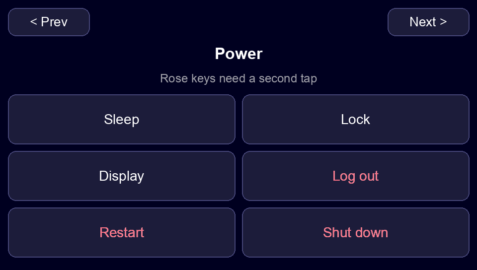
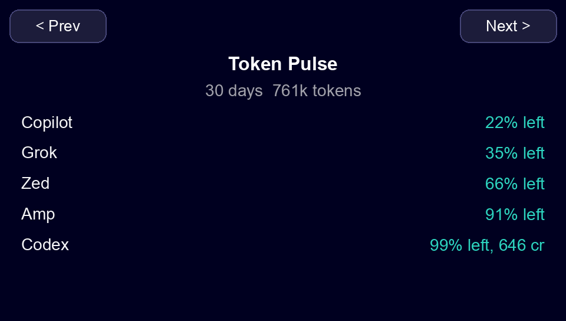

# JC4827 desk pad

This fork is [geeksville/touchy-pad](https://github.com/geeksville/touchy-pad) on a Guition JC4827W543. The panel is an ESP32-S3 with a 4.3 inch 480×272 screen, an NV3041A display, and a GT911 touch sensor. USB shows up as **Touchy-Pad**.

Five pages share one prev/next bar. The files sort `apps`, `power`, `tomato`, `trackpad`, `usage`.

```bash
just dev
```

That starts what the pages need and leaves it running. Tuna for the app keys. CodexBar and the `pulse` helper for Token Pulse, the tomato countdown, and the power keys. The trackpad needs no host process. Ctrl-C stops the USB helper. Do not start `clock` as well: the pad has one USB link.

## Apps

Requires [Tuna](https://tunaformac.com/). No helper has to stay open after the page is stored.

Eight keys are the app icons, with no extra background. The transparent corners show the screen. A tap sends the Hyper chord (`ctrl+opt+shift+cmd` plus a key) that Tuna already uses.


| Button | Opens | Chord |
| --- | --- | --- |
| Zen | Zen | Hyper+E |
| Zed | Zed Preview | Hyper+C |
| Amp | Amp | Hyper+A |
| Ghostty | Ghostty | Hyper+Tab |
| Slack | Slack | Hyper+S |
| Mail | Canary Mail | Hyper+M |
| Grok | Grok Bot | Hyper+B |
| Spotify | Spotify | Hyper+R |

The chords come from `~/Projects/dotfiles` `macos/.config/tuna/config.toml` on `master`. Combo mode is off in that file, so only the `hotkeys.custom` entries are used.

## Power

Requires the `pulse` helper. The keys call macOS through that process. Quit it and the buttons stop.



Sleep, Lock, and Display run on the first tap. Display turns the screen off and leaves the Mac awake. Log out, Restart, and Shut down are rose: tap once, read the line, then tap that key again within 5 seconds.

The first time, macOS may ask to let the helper control System Events. Lock sends Ctrl-Command-Q, so the helper also needs Accessibility if that prompt appears.

## Token Pulse

Requires [CodexBar](https://github.com/steipete/CodexBar) and the `pulse` helper. The pad cannot call `127.0.0.1`, so both have to keep running.



A usage page in the same shape as [token-pulse](https://github.com/jellydn/token-pulse). It lists the providers you are using. Each row is the remaining percent. A credit balance is added on that same row when the provider has one. The 30-day token total counts that same set. Under 20% left is rose. The rest is teal.

The helper polls CodexBar and rewrites the page when a number changes:

```bash
codexbar serve --host 127.0.0.1 --port 8899 --refresh-interval 60 --identity redacted
cd app
poetry run python ../scripts/desk/desk.py pulse
```

Leave both running. Quit `pulse` and the last numbers stay on the glass.

## Tomato

Requires the `clock` helper. macOS uses `afplay` and `osascript` for the chime. Quit the helper and the buttons stop.

A 25-minute focus timer. A short break is 5 minutes. After four focus sessions the break is 15 minutes. **Start**, **Pause**, **Skip**, and **Reset** sit under the clock.


The digits are a label. The helper rewrites the page once a second so the number changes. Leave this process running:

```bash
cd app
poetry run python ../scripts/desk/desk.py clock
```

Quit it and the page stays, but the time freezes and the four buttons stop. A phase change plays a sound and posts a macOS notification.

The clock was stopping because the USB link dropped and that process exited. It counted in the host, then a cable unplug made the next picture write fail (`USBError: No such device`), and the helper had no retry. It now waits for the pad and keeps the same countdown. Use a USB data cable in the board USB-C port. A charge-only cable never connects.

## Trackpad

Requires no extra tool. The firmware sends the pointer over USB HID.

The multitouch touchpad from `touchy init`, with the ITMAN mark as the backdrop.


One finger moves the pointer. A tap clicks. Two fingers scroll. The gesture set is the stock touchy-pad trackpad.

## Put the pages back

The steps, the script, and the flash notes are in [docs/desk-guide.md](docs/desk-guide.md).

```bash
cd app
poetry install
poetry run python ../scripts/desk/desk.py setup
poetry run python ../scripts/desk/desk.py clock
```

`setup` writes Apps, Tomato, and Trackpad, then shows **Apps**. Token Pulse is a separate `pulse` command. The pad has one USB link, so `pulse` keeps the tomato countdown as well when that session is still running. Stop that process before `setup`.

To write firmware, use a data cable, hold **BOOT**, tap **RST**, release **BOOT**, then `just up`. That lists `/dev/cu.*` and flashes the one USB serial port. `just` and `esptool` are the flash tools. Details are in the guide.

The pictures above are the four pages at the panel size (drawn at 2×). This board has no screen-capture command, so they are the layouts that are on the glass, not a photo of the LCD.
