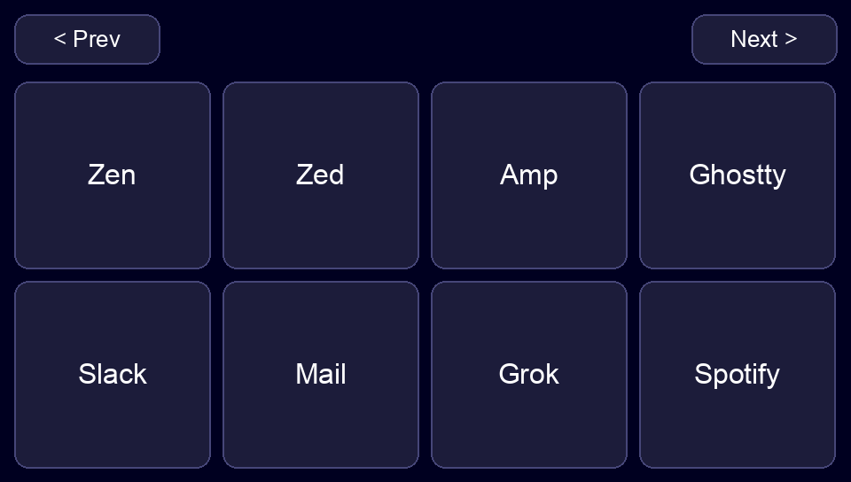
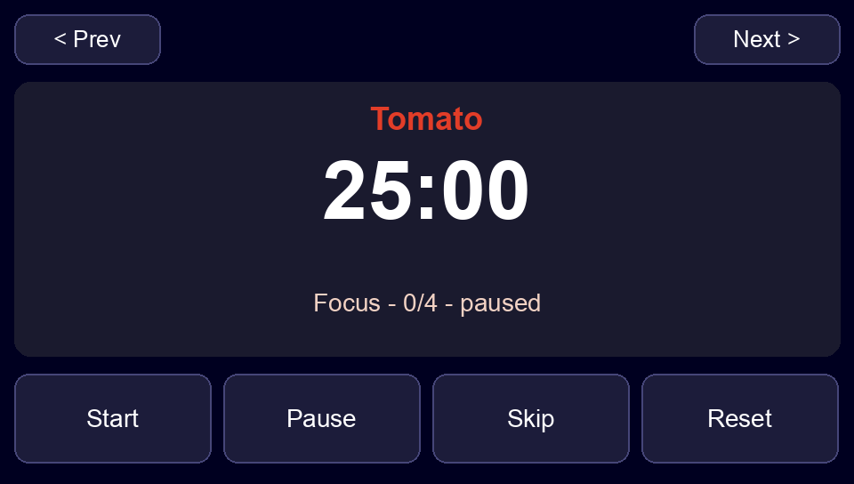
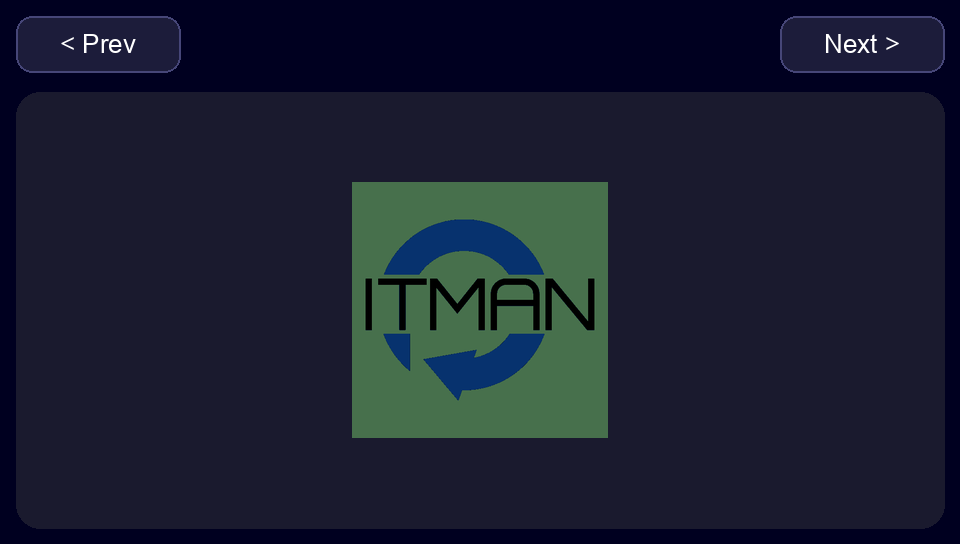

# JC4827 desk pad

This fork is [geeksville/touchy-pad](https://github.com/geeksville/touchy-pad) on a Guition JC4827W543. The panel is an ESP32-S3 with a 4.3 inch 480×272 screen, an NV3041A display, and a GT911 touch sensor. USB shows up as **Touchy-Pad**.

Three pages share one prev/next bar. The files sort `apps`, `tomato`, `trackpad`.

## Apps

Eight keys are the app icons, with no extra background. The transparent corners show the screen. A tap sends the Hyper chord (`ctrl+opt+shift+cmd` plus a key) that Tuna already uses. Tuna must be running. No helper has to stay open for these keys.



| Button | Opens | Chord |
| --- | --- | --- |
| Zen | Zen | Hyper+E |
| Zed | Zed Preview | Hyper+C |
| Amp | Amp | Hyper+A |
| Ghostty | Ghostty | Hyper+Tab |
| Slack | Slack | Hyper+S |
| Mail | Canary Mail | Hyper+M |
| Grok | Grok Bot | Hyper+B |
| Spotify | Spotify | Hyper+R |

The chords come from `~/Projects/dotfiles` `macos/.config/tuna/config.toml` on `master`. Combo mode is off in that file, so only the `hotkeys.custom` entries are used.

## Tomato

A 25-minute focus timer. A short break is 5 minutes. After four focus sessions the break is 15 minutes. **Start**, **Pause**, **Skip**, and **Reset** sit under the clock.



The digits are a label. The helper rewrites the page once a second so the number changes. Leave this process running:

```bash
cd app
poetry run python ../scripts/desk/desk.py clock
```

Quit it and the page stays, but the time freezes and the four buttons stop. A phase change plays a sound and posts a macOS notification.

The clock was stopping because the USB link dropped and that process exited. It counted in the host, then a cable unplug made the next picture write fail (`USBError: No such device`), and the helper had no retry. It now waits for the pad and keeps the same countdown. Use a USB data cable in the board USB-C port. A charge-only cable never connects.

## Trackpad

The multitouch touchpad from `touchy init`, with the ITMAN mark as the backdrop.



One finger moves the pointer. A tap clicks. Two fingers scroll. The gesture set is the stock touchy-pad trackpad.

## Put the pages back

The steps, the script, and the flash notes are in [docs/desk-guide.md](docs/desk-guide.md).

```bash
cd app
poetry install
poetry run python ../scripts/desk/desk.py setup
poetry run python ../scripts/desk/desk.py clock
```

`setup` writes all three pages and shows **Apps**. `clock` has to stay running for the tomato page. Stop `clock` before `setup`. Both use the same USB command link.

To write firmware, use a data cable, hold **BOOT**, tap **RST**, release **BOOT**, then `just up`. That lists `/dev/cu.*` and flashes the one USB serial port. Details are in the guide.

The pictures above are the three pages at the panel size (drawn at 2×). This board has no screen-capture command, so they are the layouts that are on the glass, not a photo of the LCD.
